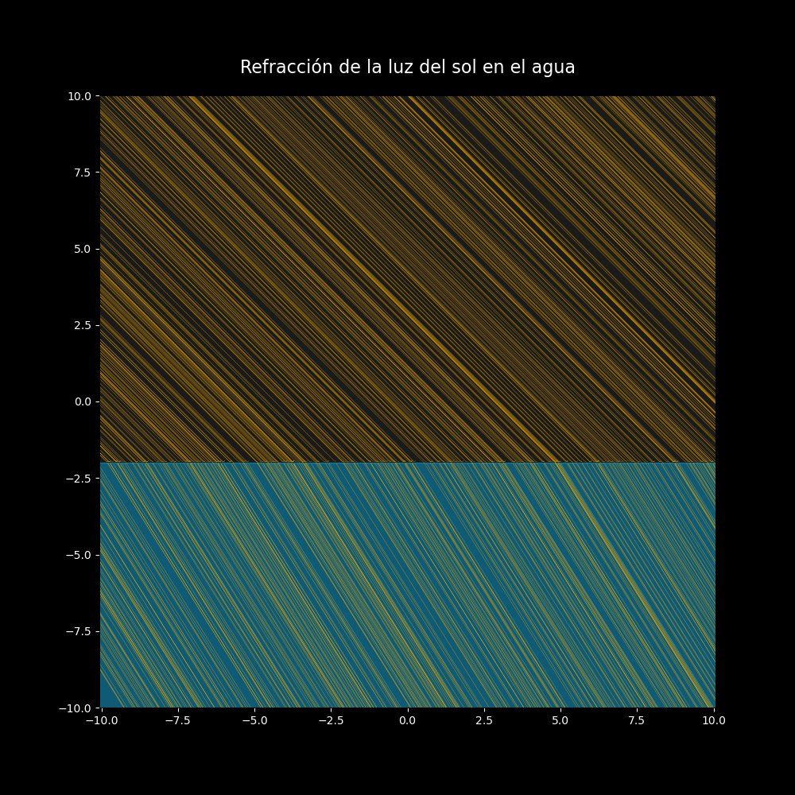
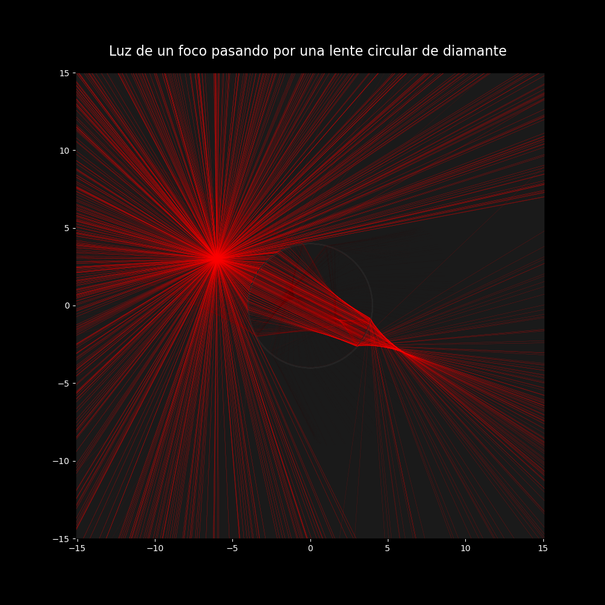
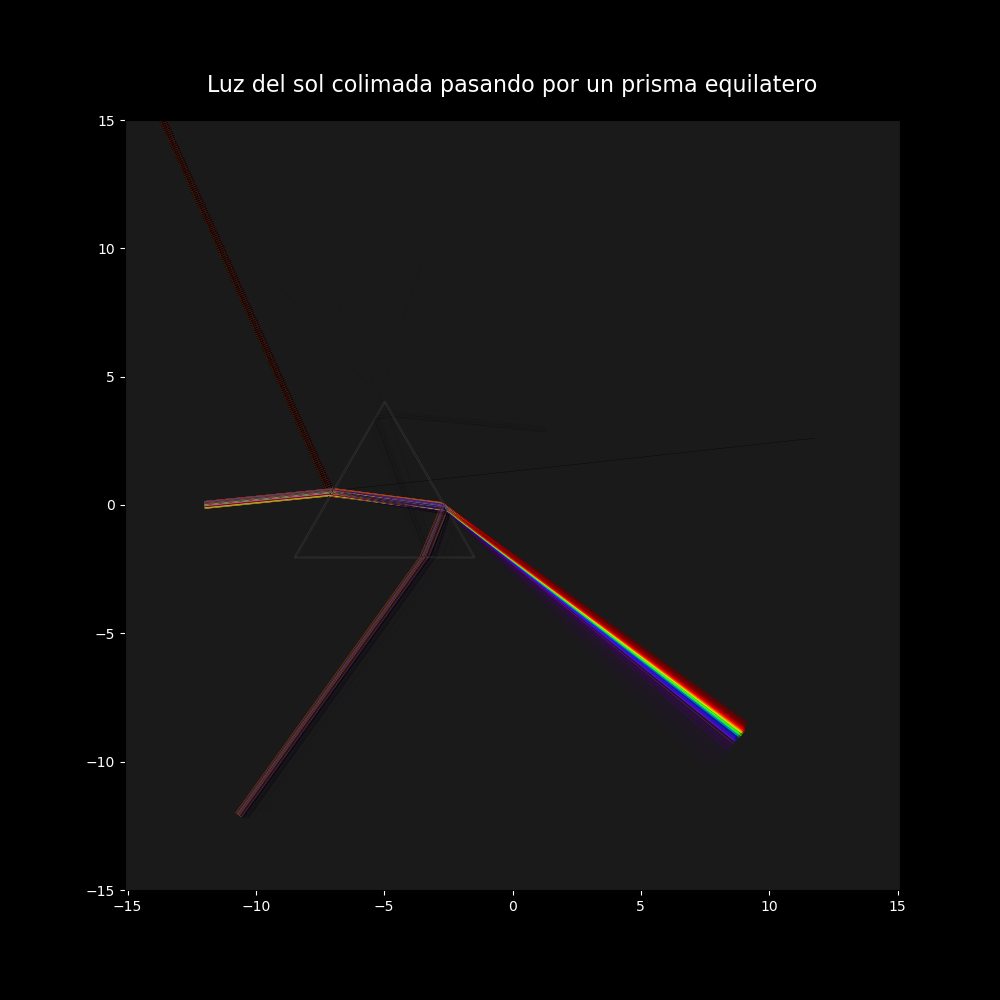
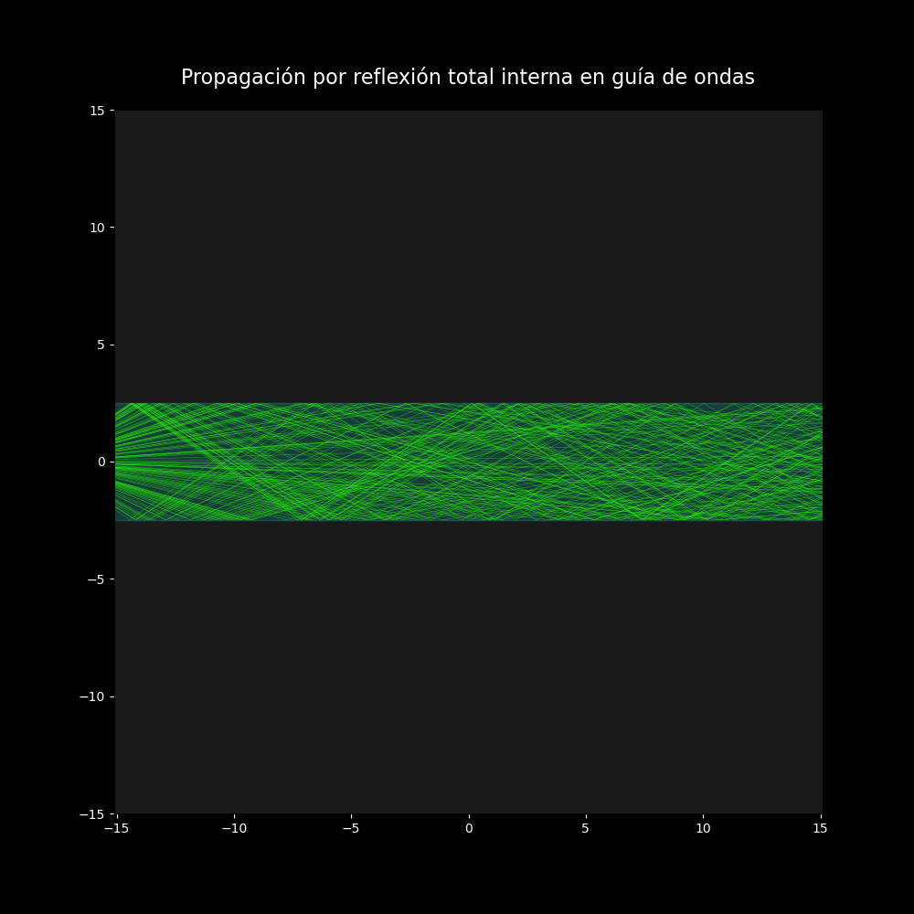
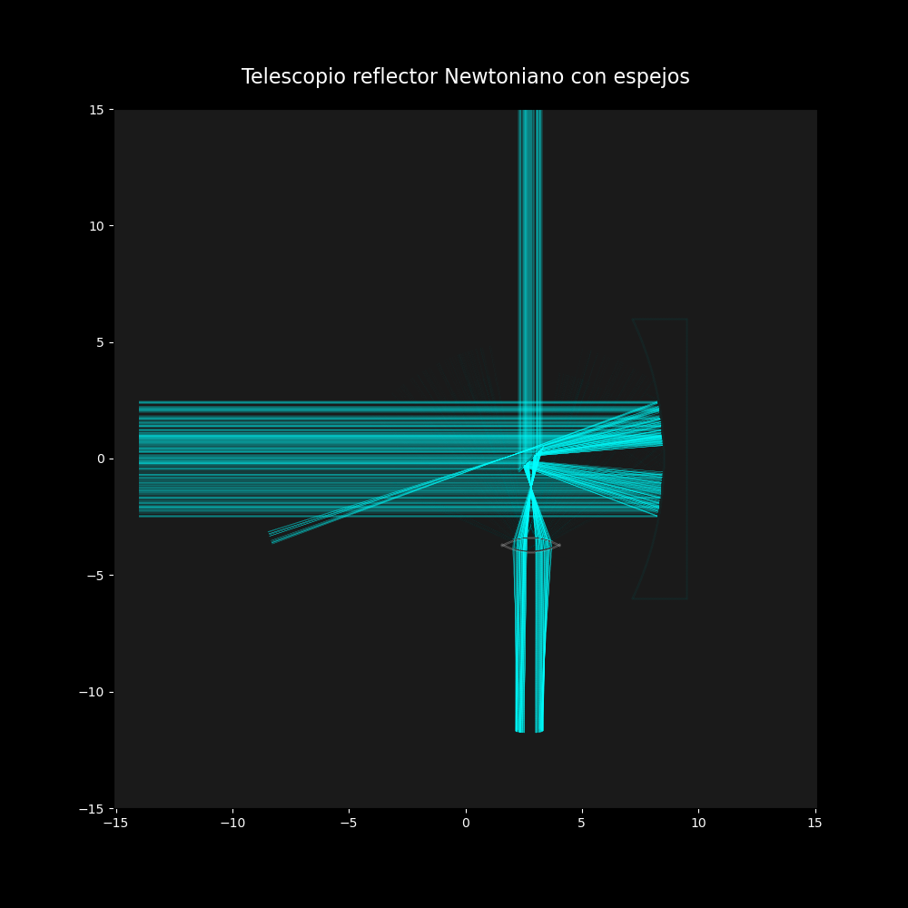
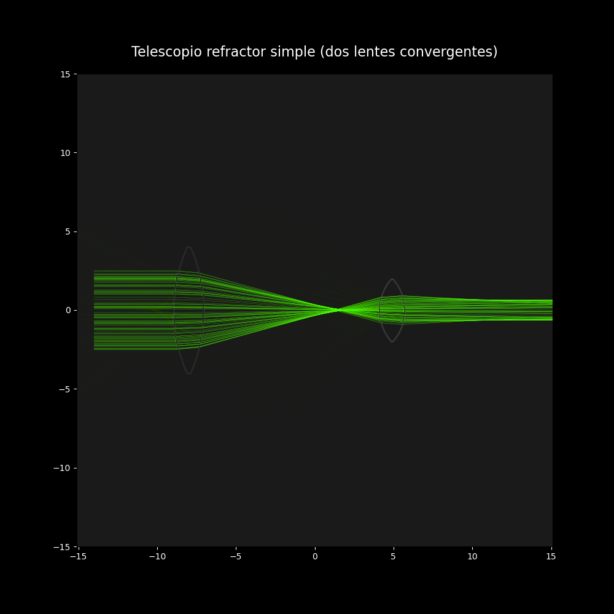

# rayos2d: Simulación de Óptica Geométrica

**rayos2d** es una librería en Python para la simulación numérica de trazado de rayos (Ray Tracing) en 2D. Permite colocar objetos ópticos (lentes, prismas, espejos, interfaces), lanzar rayos desde una fuente y ver cómo se refractan, se reflejan y se separan por colores.

📘 **[Manual de usuario (PDF)](Documentos/ManualUsuario.pdf)**: guía completa con todas las funciones, opciones y ejemplos.

**Qué simula:**

- Refracción y reflexión en cada superficie, con la fracción de luz reflejada o transmitida (coeficientes de Fresnel).
- Dispersión cromática: cada color se desvía un ángulo distinto, según el material.
- Reflexión total interna y espejos ideales.

## 🖼️ Galería de ejemplos

Haz clic en una imagen o en el enlace para ver el script correspondiente.

| | | |
|:---:|:---:|:---:|
| [](Ejemplos/Prueba1.py) | [](Ejemplos/Prueba6.py) | [](Ejemplos/Prueba4.py) |
| **Refracción en el agua** <br> [Ver ejemplo](Ejemplos/Prueba1.py) | **Lente circular de diamante** <br> [Ver ejemplo](Ejemplos/Prueba6.py) | **Dispersión cromática por prisma** <br> [Ver ejemplo](Ejemplos/Prueba4.py) |
| [](Ejemplos/Prueba8.py) | [](Ejemplos/Prueba9.py) | [](Ejemplos/Prueba5.py) |
| **Fibra óptica (reflexión total interna)** <br> [Ver ejemplo](Ejemplos/Prueba8.py) | **Telescopio de espejos** <br> [Ver ejemplo](Ejemplos/Prueba9.py) | **Telescopio refractor** <br> [Ver ejemplo](Ejemplos/Prueba5.py) |

> **Nota sobre los ejemplos:** no es necesario instalar el paquete para correr los scripts de `Ejemplos/`. Están pre-configurados para funcionar inmediatamente.

## 🚀 Instalación

Requisitos: Python 3, `numpy` y `matplotlib`.

1. Abre una terminal en la carpeta raíz de este proyecto (donde está este archivo README).
2. Ejecuta:

```bash
pip install .
```

## ⚡ Inicio rápido

Un sistema óptico se construye siempre en este orden:

1. **Materiales**: de qué está hecho cada objeto.
2. **Objetos**: las piezas ópticas.
3. **Fuente**: la luz que se lanza.
4. **Sistema**: junta todo, calcula el recorrido de los rayos y lo dibuja.

Ejemplo: luz blanca atravesando un prisma de vidrio.

```python
import numpy as np
import matplotlib.pyplot as plt

from rayos2d import Objetos, Materiales as MT
from rayos2d.Fuentes import Fuentes
from rayos2d.Evolucion import SistemaOptico

np.random.seed(0)    # resultado reproducible

prisma = Objetos.TrianguloEquilatero((-5, 0), 7, material=MT.BK7)
luz = Fuentes.haz_colimado((-12, 0), 0.2, (1, 0.1), 200,
                           lam=0.55, lam_ancho=0.2, lam_dist='gaussiana')

sistema = SistemaOptico(prisma, luz)
sistema.evolucionar(pasos=3000, dt=0.01, MAX_RAYOS=5000)
sistema.graficar()
plt.show()
```

> Las longitudes de onda se dan en **micrómetros** (el visible va de `0.38` a `0.78`). Las coordenadas y tamaños están en unidades arbitrarias, pero deben ser consistentes entre sí.

## 🧩 Componentes

Esta es una versión resumida. Todas las opciones, con su descripción y valores por defecto, están en el [manual de usuario](Documentos/ManualUsuario.pdf).


### 1. Materiales (`Materiales`)

Definen el índice de refracción $n(\lambda)$. Se usan como `MT.nombre`:

| Material | Descripción | n aprox. (0.55 µm) |
|---|---|:---:|
| `MT.Aire` | Ambiente por defecto | 1.0003 |
| `MT.Agua` | Agua | 1.33 |
| `MT.PMMA` | Acrílico | 1.49 |
| `MT.CristalComun` | Vidrio común (por defecto en los objetos) | 1.51 |
| `MT.BK7` | Vidrio óptico (borosilicato) | 1.52 |
| `MT.SF10` | Vidrio flint, alta dispersión | 1.73 |
| `MT.Diamante` | Diamante | 2.42 |
| `MT.SiC` | Carburo de silicio | 2.66 |
| `MT.Espejo` | Espejo ideal: refleja el 100 % | — |

Para crear uno propio: `Material(nombre, coeficientes, modelo=0, es_espejo=False)`. Por ejemplo, un vidrio de índice constante:

```python
from rayos2d.Materiales import Material
MiVidrio = Material("Vidrio n=1.7", [1.7, 0, 0, 0, 0, 0, 0, 0], modelo=2)
```

### 2. Objetos (`Objetos`)

| Objeto | Sintaxis (obligatorios primero) |
|---|---|
| Línea que separa dos medios o espejo plano | `Interfaz(centro, normal, material, longitud=30)` |
| Rectángulo | `Rectangulo(centro, A, B, material, normal=(-1, 0))` |
| Prisma (triángulo equilátero) | `TrianguloEquilatero(centro, L, material, direccion=(0, 1))` |
| Lente de caras esféricas o planas | `Lente(centro, radios, grosor, apertura, material, direccion=(0, 1))` |
| Corazón | `Corazon(centro, escala=1.0, material)` |

Opciones comunes: `material` (por defecto `MT.CristalComun`) y el número de puntos de la frontera (`num_points`, por defecto `2000`; en `Lente` y `Corazon` se llama `num_puntos`). `normal` y `direccion` sirven para **rotar** el objeto.

**Lentes.** `radios=(R1, R2)` son los radios de la cara izquierda y derecha (la luz entra por la izquierda). Una cara plana se escribe `np.inf`.

| Tipo | `radios` | Ejemplo |
|---|---|---|
| Biconvexa (converge) | `R1 > 0, R2 < 0` | `(8, -8)` |
| Bicóncava (diverge) | `R1 < 0, R2 > 0` | `(-8, 8)` |
| Plano-convexa | `R1 = inf, R2 < 0` | `(np.inf, -8)` |
| Plano-cóncava | `R1 = inf, R2 > 0` | `(np.inf, 8)` |
| Menisco | mismo signo | `(20, 40)` |

Cada radio debe ser, en valor absoluto, mayor que `apertura/2`. Para revisar la forma de un objeto antes de simular: `Objetos.graficar_lente(ax, objeto, titulo)`.

### 3. Fuentes (`Fuentes`)

| Fuente | Sintaxis |
|---|---|
| Punto que emite en un cono o en todas direcciones | `Fuentes.fuente_puntual(origen, N, angulo_apertura=360)` |
| Haz de rayos paralelos (Sol, láser ancho) | `Fuentes.haz_colimado(centro, ancho_haz, direccion, N)` |

Ambas aceptan las opciones de color `lam` (longitud de onda central, `0.55`), `lam_ancho` (`0.0`) y `lam_dist`:

| `lam_dist` | Efecto |
|---|---|
| `'monocromatica'` | Un solo color (`lam`) |
| `'uniforme'` | Longitudes de onda repartidas parejo en `lam ± lam_ancho` |
| `'gaussiana'` | Campana de Gauss con media `lam` y desviación `lam_ancho` |

Para **luz blanca**: `lam=0.58, lam_ancho=0.2, lam_dist='uniforme'`.

### 4. Sistema óptico (`Evolucion`)

```python
sistema = SistemaOptico(objetos, fuente, ambiente=MT.Aire)   # objetos: uno o una lista
sistema.evolucionar(pasos=1500, dt=0.008, distMin=0.02, MAX_RAYOS=100000, min_int=0.01)
sistema.graficar()      # luego plt.show() o plt.savefig(...)
```

| Opción | Descripción | Por defecto |
|---|---|:---:|
| `ambiente` | Medio que rodea a los objetos (p. ej. `MT.Agua`) | `MT.Aire` |
| `pasos` | Pasos de la simulación | `1500` |
| `dt` | Distancia que avanza cada rayo por paso (recorrido total = `pasos * dt`) | `0.008` |
| `distMin` | Distancia a la que un rayo detecta una superficie (debe ser mayor que `dt`) | `0.02` |
| `MAX_RAYOS` | Máximo de rayos, contando los que nacen de reflexiones y refracciones | `100000` |
| `min_int` | Intensidad mínima: por debajo, el rayo se apaga | `0.01` |

`graficar()` colorea cada rayo según su longitud de onda y su transparencia según su intensidad. La vista inicia en $x,y \in [-15,15]$; para cambiarla usa `plt.xlim` y `plt.ylim` después de `graficar()`.

## 🛠️ Consejos y problemas comunes

- **Una fuente sirve para una sola simulación.** `evolucionar` modifica sus rayos; para repetir, crea una nueva.
- **Resultados reproducibles:** usa `np.random.seed(0)` al inicio.
- **Los rayos atraviesan un objeto:** aumenta `num_points`, aumenta `distMin` o reduce `dt` (siempre `dt < distMin`).
- **Los rayos no llegan al final:** aumenta `pasos` o `dt`.
- **Aviso «Máximo de rayos alcanzado»:** aumenta `MAX_RAYOS`, reduce `N` o sube `min_int`.
- **La luz entra por el lado equivocado de una interfaz:** invierte el signo de `normal` (debe apuntar al ambiente).
- **Memoria y tiempo:** crecen con el número de rayos por el de puntos de frontera; empieza con cientos de rayos.

## 📂 Estructura del paquete

* **rayos2d/**: código fuente de la librería.
* **Documentos/**: * **Documentos/**: [manual de usuario](Documentos/ManualUsuario.pdf) (PDF) con todas las opciones y más detalles.
* **Ejemplos/**: scripts listos para ejecutar. Las imágenes de la galería están en `Ejemplos/Graficos/`.

## 👤 Autor

Desarrollado por: Eduardo Daniel Delgado Arellano

Contacto: danyp2mwf@gmail.com

## 📄 Licencia

Este código es de uso libre con la correspondiente mención del autor.